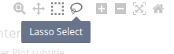
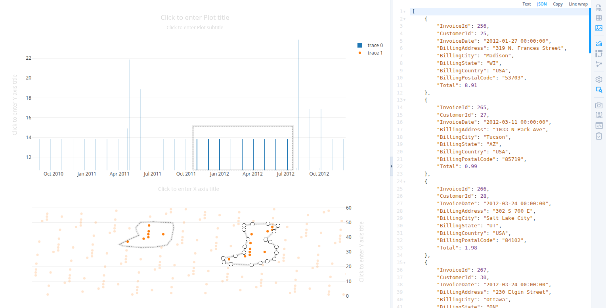

# How to view point details in chart visualization

To see the full data corresponding to selected points of the chart, first
open the detail panel by clicking  in the side menu.
Then turn on box or lasso selection mode using plotly menu bar.

Select one or more points. You can apply multiple selections holding
`Shift` key. The detail panel will show full data for all points inside
all selections.

Double click in chart area to remove selections.
